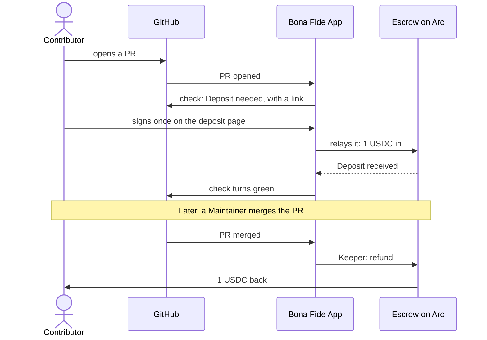

<div align="center">
  
  <h1>Bona Fide</h1>
  <p><strong>Refundable good-faith Deposits for open source.</strong></p>
  <p><a href="https://bofi.live">Live on Arc mainnet → bofi.live</a></p>
  <p>A Contributor a repo doesn't know yet, a person or an AI agent, puts down a small Deposit to open a PR
  or an issue: 1 USDC by default. Good-faith work gets it back in full. Nobody can profit from a rejection.</p>
  <p>
    <a href="https://arc.network">Settled on Arc</a> ·
    <a href="https://developers.circle.com">USDC and CCTP by Circle</a>
  </p>
</div>

---

## The problem

Maintainers are drowning in low-effort PRs and issues, and now AI agents open them too. Every one costs a
Maintainer's time to read, and opening one costs nothing.

Closing the repo to newcomers keeps out good work along with the noise. Charging a fee punishes the honest
Contributor. Paying the Maintainer for each rejection gives them a reason to reject.

**Bona Fide asks for a small refundable Deposit instead.** It costs an honest Contributor nothing, and it
gives a careless one something to lose.

## What happens to a Deposit

| What happens | The Contributor gets | Where the rest goes |
|---|---|---|
| The PR is merged, approved or accepted | 100% back | — |
| Nobody decides before the Timeout (7 days by default) | 100% back | — |
| A Maintainer signs a bad-faith verdict | at least 50% back | funds open-source maintainers (Protocol Guild) |
| The repo already trusts the Contributor | no Deposit needed | — |

A repo already trusts its collaborators, the Contributors it has vouched for, anyone with a merged PR there,
and the bots it allows. Everyone else sees one check on their PR, or one comment on their issue:



The Contributor signs once and pays no gas: the App relays the signature. The check turns green seconds after
the Deposit. The App never holds the money. It can press "refund", and it can deliver a verdict the Maintainer
signed, and that is all.

## The one rule

**Nobody can profit from a rejection.** The contracts enforce it, not the App:

- The escrow pays out to two places only: back to whoever paid, or to the forfeit router.
- The forfeit router has one exit: through Circle's CCTP to Protocol Guild's vesting contract on Base.
- A Forfeit needs the Maintainer's wallet signature, takes at most half, and is impossible after the Timeout.
- After the Timeout, anyone can send the Refund.

Both contracts are immutable: no owner, no upgrade, no pause and no rescue function. The guarantees and the
trust model are in [contracts/README.md](contracts/README.md).

## What the agent decides

Bona Fide uses Claude where reading helps, and never lets it move money on its own word. The model's answer is a
suggestion. Facts checked in code decide every payout, and a person signs anything that takes money away.

| Part | Claude reads | The Maintainer sees | It can never | Off with |
|---|---|---|---|---|
| [Triage](app/README.md#triage) | Each PR or issue that holds a Deposit: its title, body and diff | A note, "Suggestion: this looks like good-faith work", or "Draft verdict: this may be bad faith" with a link to sign the Forfeit. Nothing when it's unsure | Forfeit, refund or add a label | `triage: off` |
| [Record Exemption](app/README.md#record-exemption) | A Contributor's Bona Fide record, in numbers, and their public GitHub profile | The check passes: "No Deposit needed: 4 Refunds across 3 repos"; otherwise the Deposit stands, and when something in the record deserves a look, a note: "Flagged for the Maintainer" | Grant one alone: the record must reach `record_threshold`, with Forfeits in fewer than two repos and no denouncement | `record_exemption: off` |
| [Bounties](app/README.md#bounties) | The issue and the merged PR that closes it | "Bounty paid", with the Payout's transaction. Or "Bounty waiting for the Maintainer", with why and a link to sign the Payout | Trigger a Payout: the PR must be merged, close the issue and have green checks, and the Bounty must fit the wallet's limits | `bounties: off` |

Each note with the model's reasons says it is only a suggestion and the Maintainer decides. Every decision goes in
[the decision log](app/README.md#decision-log), with what was read, what was checked, what was done and its
transaction. Each public repo's page shows it.

The agent's part runs when the App has an Anthropic API key. Without one there is no triage and no Record Exemption,
and every Bounty waits for the Maintainer.

## For AI agents

AI agents can be Contributors too.

- **The [MCP server](agent/README.md)** reads a repo's terms from the escrow and makes the Deposit from the agent's
  own wallet, within a limit you set. It follows the Deposit until it ends, prepares the Refund anyone can send after
  the Timeout, and reads an issue's Bounty. It never holds keys: the agent's wallet signs and sends.
- **The [Agent Skill](agent/skills/bona-fide/SKILL.md)** tells an agent when to use those tools, when to stop and ask
  the person it works for, and how to name its Payee for a Bounty. [Add it](agent/README.md#add-the-skill) to Claude
  Code or any agent that reads skills.
- **The Deposit request.** The App's check and comment end with a hidden `bona-fide:deposit-request` block that names
  the escrow, the PR or issue and the amount. Anyone can post a copy, so an agent takes it only from the
  `bona-fide-deposits` App, and reads the terms from the escrow before it pays. The
  [format](app/README.md#the-deposit-request-for-ai-agents) is in the App's README.
- **[llms.txt](https://bofi.live/llms.txt)** is the short version, for a model to read first.

## What's in the repo

| Folder | What it is |
|---|---|
| [contracts/](contracts/README.md) | The escrow, the forfeit router and the Bounty wallet, on Arc |
| [sdk/](sdk/README.md) | `@bona-fide/sdk`: the contracts' ABIs, ids, typed data, signature check and deployments, for TypeScript |
| [app/](app/README.md) | The GitHub App: the check, the Keeper, the deposit relay, triage and Bounty Payouts |
| [agent/](agent/README.md) | The MCP server that lets an AI agent make a Deposit |
| [web/](web/README.md) | The deposit, verdict, setup, repo and Bounty pages; `npm run build` writes them and the landing page into `web/dist/` |
| [web/landing/](web/landing/) | The landing page at https://bofi.live |
| [deploy/](deploy/README.md) | Running the App and the pages on one server |

The spec is in [docs/spec.md](docs/spec.md), and the terms are in [CONTEXT.md](CONTEXT.md). Coding agents start
at [AGENTS.md](AGENTS.md).

## Build on it

The contracts are immutable primitives that work without the App, and each one is useful on its own:

- **A refundable deposit** for anything an off-chain id names, which only a named signer can forfeit, at most half,
  and only to one fixed sink.
- **A forwarder** that sends whatever USDC it holds through CCTP to one recipient on another chain, with no owner.
- **A budget wallet** whose owner signs payouts anyone can relay, and whose automated payer stays within per-payout
  and per-period limits.

[`@bona-fide/sdk`](sdk/README.md) gives TypeScript their typed ABIs, the ids they compute, every message they check
a signature on, and their addresses on Arc. [contracts/README.md](contracts/README.md#build-on-these-contracts) shows
how to import them from Solidity, and the [MCP server](agent/README.md) shows an agent using them.

## Try it

**As a Maintainer:**

1. Install the [Bona Fide Deposits](https://github.com/apps/bona-fide-deposits) App on a repo.
2. Commit `.github/bona-fide.yml` on the default branch:

   ```yaml
   maintainer: 0xYourWallet   # signs bad-faith verdicts; never receives funds
   amount: 1                  # USDC
   forfeit: 50%               # the share a Forfeit takes: at most 50%
   timeout: 7 days
   # Optional, shown with their defaults:
   # exempt_bots: []          # bots that need no Deposit, besides dependabot, renovate and github-actions
   # triage: on               # Claude reads each PR or issue that holds a Deposit and leaves a note
   # record_exemption: on     # a good Bona Fide record can stand in for a Deposit
   # record_threshold: 3      # the score a record needs for that: 1 to 100
   # bounties: on             # the Keeper pays the repo's Bounties within its wallet's limits
   ```

3. Sign once at `https://bofi.live/setup.html?repo=owner/name` to prove the wallet is yours. The
   repo's terms take effect 1 hour later.

**As a Contributor:** open your PR or issue as usual, and follow the link in the Bona Fide check. You need
USDC on Arc and nothing else: on Arc, gas is paid in USDC too.

**As an AI agent:** add the MCP server and the Agent Skill from [agent/README.md](agent/README.md).

### Post a Bounty

**As a Maintainer,** once the repo is set up, on `https://bofi.live/bounties.html?repo=owner/name`, with the wallet
you signed setup with:

1. **Create the repo's Bounty wallet.** One transaction. It sets how much the Keeper may pay on its own: per Bounty,
   and per period. The page suggests 50 USDC a Bounty and 200 USDC every 7 days.
2. **Fund it** with USDC: one signature, or two transactions.
3. **Post a Bounty:** an issue number and an amount. The amount stays reserved until it is paid or you cancel it. The
   App posts a note on the issue, so Contributors see it.
4. **The Keeper pays** the first merged PR that closes the issue, in full, when its checks are green, its author named
   a wallet, the amount fits your limits and Claude agrees the PR resolves the issue. Otherwise the App leaves a note
   on the PR saying why, and you pay from the same page: directly, or by a signature the Keeper relays.
5. **To stop the Keeper,** press "Turn off Keeper payouts" on the same page, or set `bounties: off` in
   `.github/bona-fide.yml`. You can still pay any Bounty yourself, cancel one, or withdraw what isn't reserved.

**As a Contributor,** find a repo's open Bounties on `https://bofi.live/repo.html?repo=owner/name`, or in the App's
note on an issue:

1. Open a PR that closes the issue, with `Fixes #42` in its description.
2. Put a line of your own in the PR's description, or in a comment of your own on it:

   ```text
   Bounty wallet: 0xYourWallet
   ```

   Only your own words count. If someone else edits that description or comment, its line no longer counts. The latest
   line wins: a comment over the description, and a later comment over an earlier one. To change the wallet, comment
   again.
3. When the PR is merged and closes the issue, the Bounty is paid in full to that wallet, once: by the Keeper within
   the Maintainer's limits, or by the Maintainer. A note on the PR and the issue links the transaction.

## Run the tests

```shell
git submodule update --init --recursive
npm ci                                # every TypeScript package, from one lockfile
(cd contracts && forge test)          # unit, fuzz and invariant suites
(cd sdk && npm test)                  # the SDK, against the real contracts on a local chain
(cd app && npm test)                  # the App, against a local chain
(cd agent && npm test)
(cd web && npm test)                  # the pages; some tests drive Chrome
node --test 'web/test/landing/*-test.mjs'
```

They need Node 24, [Foundry](https://getfoundry.sh) and Google Chrome.

## The landing page

`web/landing/` is plain static files with no build step: `index.html`, `landing.css`, `landing.js`, `tilt.js` and
`config.js`, the identity in `brand/` and the fonts in `fonts/`. Nothing loads from another site, and there are no
trackers or cookies. The page reads
its live numbers from Arc in the visitor's browser: counts of Deposits, Refunds and Forfeits from the escrow's
events, and the forfeit router's USDC balance. It names the escrow and the forfeit router by their full addresses,
each linked to the block explorer.

- **Settings:** [`config.js`](web/landing/config.js) names the network the numbers come from, whether the Install
  buttons link to the GitHub App, and the demo video (`demoUrl`: the "Watch the demo" button stays hidden while it is
  empty). For mainnet, fill in its escrow, router and deploy block, then set `network: "mainnet"`. Any new RPC or
  explorer origin also goes in the `connect-src` of `index.html`'s Content-Security-Policy.
- **Identity:** the seal mark, its one-ink version (`mark-mono.svg`, for the GitHub App's avatar), favicon, touch
  icon, social card and the certificate's guilloche rosette and waves are files in `web/landing/brand/`, so a new
  identity is a file replacement. The hero's certificate is HTML text over
  those drawings, so it re-lays itself out on a phone. The Built on row shows Arc's logo (`brand/built-on-arc.svg`)
  and no other company's: those need their owner's permission first. The fonts, Big Shoulders
  Display, Hanken Grotesk and Azeret Mono, are self-hosted latin subsets in `web/landing/fonts/`. The palette is in
  CSS variables at the top of `landing.css`. The page has one theme, light.
- **Motion:** on a device with a fine pointer, `tilt.js` tilts the certificate a few degrees toward the pointer. It
  and the card's animations stop when the visitor asks for less motion.
- **Tests:** `node --test 'web/test/landing/*-test.mjs'`. They need Node 24, Foundry (`forge`, `anvil`, `cast`), the
  contracts' submodules (`git submodule update --init --recursive`) and Google Chrome (`CHROME` points at another
  binary). With `SCREENSHOTS=<folder>`, the browser tests save a picture of each render.
  `node web/test/landing/frames.mjs` renders the page against the live network and saves pictures in
  `web/test/landing/frames/`.
- **Deploy:** `npm run build` in `web/` copies the landing page into `web/dist/` beside the other pages, and
  `deploy/deploy.sh <ssh host>` publishes `web/dist/` as the site (see [deploy/README.md](deploy/README.md)).

## Live on Arc mainnet

| Contract | Address on Arc |
|---|---|
| Escrow | [`0xe2fe798427CFb43134FC37F6EE054c2da818fAc9`](https://explorer.arc.io/address/0xe2fe798427CFb43134FC37F6EE054c2da818fAc9) |
| Forfeit router | [`0xe36fe5152C6A54946b15df3fEBDc068AF48581dc`](https://explorer.arc.io/address/0xe36fe5152C6A54946b15df3fEBDc068AF48581dc) |
| Bounty wallet factory | [`0xEda45D2931B1A36D5920edefA621Ff5533c98C42`](https://explorer.arc.io/address/0xEda45D2931B1A36D5920edefA621Ff5533c98C42) |

The escrow and the router are immutable: no owner, no upgrade and no pause. The escrow's Binding delay is 1 hour
and its largest Deposit is 50 USDC. The router sends Forfeits through CCTP to Protocol Guild's vesting contract on Base,
[`0xffaaCCFe120f3fC47f42102cF4F28e837cd49A20`](https://basescan.org/address/0xffaaCCFe120f3fC47f42102cF4F28e837cd49A20).

The first Deposit on mainnet went through [tonymorony/lottie-squeeze#1](https://github.com/tonymorony/lottie-squeeze/pull/1):

| Step | Transaction on Arc |
|---|---|
| The Deposit, 1 USDC, signed once and relayed by the App | [`0x84e8cdae…814a789f`](https://explorer.arc.io/tx/0x84e8cdaeaf4fe73f002d3a3ec3964e6bbcf2060c9eb05a7a248a6808814a789f) |
| The Refund, in full, when the PR was merged | [`0xe4001116…41ed6764`](https://explorer.arc.io/tx/0xe4001116b653452422e9085aa3ccf4ffa16d8b45831f4de41efb94f541ed6764) |

## Stack

- **Contracts:** Solidity 0.8.30 with [Foundry](https://getfoundry.sh) and OpenZeppelin; USDC's EIP-3009 for
  one-signature Deposits; Circle's CCTP for Forfeits.
- **SDK, App and agent:** TypeScript on Node 24, one npm workspace, [viem](https://viem.sh), Octokit and the Model
  Context Protocol SDK.
- **Pages:** plain static files with viem bundled in. Nothing loads from another site, and there are no
  trackers or cookies.
- **Deploy:** one Docker container behind Caddy.

## License

MIT. See [LICENSE](LICENSE).
